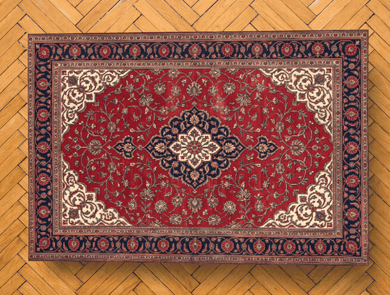
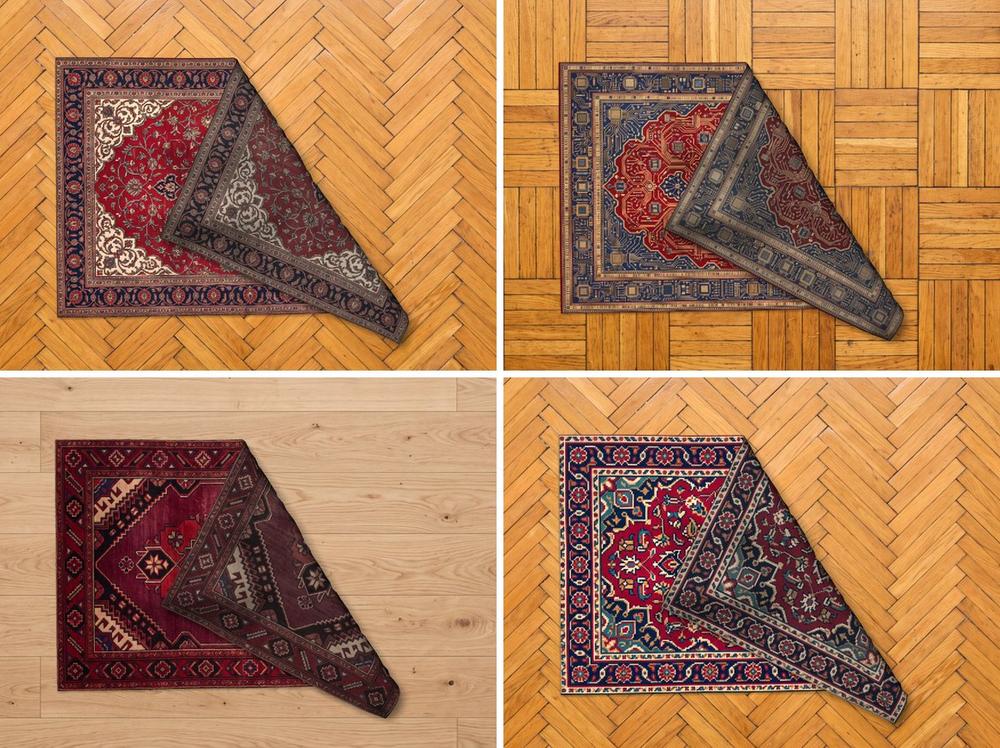

# Rug for Windows

Sweep your Windows desktop under the rug. A heavy wool rug lies on top of your desktop icons, the files make bumps in it, and you can grab any corner to peek at the mess underneath.

This is the Windows port of [Rug](../README.md). The cloth physics, the shaders and the textures are the same as in the Mac app; everything that talked to macOS (AppKit, Metal, Finder, Accessibility) was rewritten for Windows.

[Русская версия ниже](#по-русски)



## Install

1. Build it (see below) and run `build\Rug\Rug.exe`. To keep it somewhere else, copy the whole `build\Rug` folder (or unzip the `Rug-windows-x64.zip` that `release.bat` makes); the `Resources` folder has to stay next to `Rug.exe`.
2. Windows SmartScreen may warn that the app is unrecognized because it isn't signed. Click **More info**, then **Run anyway**.

Windows 10 1803 or later, Windows 11 recommended. Any GPU with Direct3D 11.

No permissions are needed. Rug reads where Explorer put your icons through the shell's own desktop view, so the bumps land in the right places.

## Use

- Drag the rug by any edge. Lift a corner, fold it over, flip the whole thing.
- Scroll over the rug to rotate it. Right-click it for a quick menu.
- The settings window opens on launch and whenever you start Rug again. Close it and the rug stays; the tray icon brings settings back (left click) or the menu (right click). Pick a rug, a floor wallpaper and the size there, or quit the app. It follows the Windows light or dark theme.
- **Start with Windows** (in settings or the tray menu) brings the rug back after every login, quietly, without opening settings. It shows up in Settings, Apps, Startup like any other startup app.
- With several monitors, drag the rug onto another screen and let go there, or pick the screen in settings or the menu. The floor wallpaper goes on the rug's screen.
- **Sweep under the rug** piles all desktop icons in a heap under the rug and drops the rug on top. **Put them back** restores the old layout. Windows must not arrange icons itself for this: on the desktop's **View** menu, **Auto arrange icons** and **Align icons to grid** have to be off. Rug offers to switch them off for you and switches them back on when you put the icons back.
- **Your image** turns any top-down picture into a rug. It works best when the rug fills the whole frame. To remove one of your rugs, point at its tile in settings and click the **×** (or right-click it), or use **Remove this rug** in the menu. Rug's copy goes to the Recycle Bin, your original picture stays where it was.

Outside the rug every click goes straight to the desktop. When nothing moves, Rug stops rendering and uses next to no CPU.

## Rugs and floors



The same four rugs and three floors as on the Mac, from [Resources](../Resources). The prompts they were generated with are in [tools/PROMPTS.md](../tools/PROMPTS.md).

## Build from source

You only need the MSVC C++ build tools, no Visual Studio project. Install **Build Tools for Visual Studio** (or Visual Studio) with the **Desktop development with C++** workload, then from this folder:

```bash
build.bat
```

```bash
build\Rug\Rug.exe
```

`build.bat` finds the compiler through `vswhere`, so it works from a plain terminal, and copies the rugs and floors from the repo's `Resources` next to the exe. `build.bat arm64` builds for Windows on ARM; that needs the optional **MSVC ARM64 build tools** component in the Visual Studio Installer. `release.bat` builds and packs `dist\Rug-windows-x64.zip`. The C runtime is linked statically, so `Rug.exe` runs without the VC++ redistributable. `tools\make_ico.py` rebuilds `src\Rug.ico` from `Resources\icon_1024.png`.

`Rug.exe --demo <folder> [rug image]` runs the scene offscreen and saves frames, handy for tuning the physics without touching your desktop. `RUG_SCENARIO=flip`, `curl` or `readme` pick other scenes, `RUG_SCENARIO=bench` whirls the rug around fast for 6 s and prints how far the hand trails and how soon the rug comes to rest (`RUG_SEED=1..4` for other drags), `RUG_FLOOR=oak` picks the floor, `RUG_FPS=180` steps the cloth at another frame rate, `RUG_COLS`, `RUG_BEND`, `RUG_FAR`, `RUG_FOLLOW`, `RUG_SPLIT`, `RUG_G` and friends override cloth parameters (see `ClothParams` in `src/Cloth.h`). `RUG_BENCH=1` with `RUG_DEBUG=1` does the same fast drag on the real desktop and logs frame rate, hitches, CPU and GPU time and the hand's lag once a second. `Rug.exe --settings-shot out.png` renders the settings window to a picture, `Rug.exe --floor oak` or `--floor restore` sets the wallpaper from the command line. `RUG_DEBUG=1` writes a detailed log to `%LOCALAPPDATA%\Rug\Rug.log` (frame rate, simulation time, memory), `RUG_LANG=ru` or `en` forces the interface language, `RUG_THEME=dark` or `light` the settings theme.

## How it works

- A transparent borderless window sits directly above the window that holds the desktop icons (`Progman`) and below every other window. It stays click-through (`WS_EX_LAYERED | WS_EX_TRANSPARENT`) except while the cursor is over the rug; the hit test runs against the projected cloth mesh 30 times a second. If "Show desktop" brings the desktop forward, the rug follows it.
- The cloth is the same XPBD solver as on the Mac, with substeps, long-range tethers and self-collisions through a spatial hash, following [Ten Minute Physics](https://matthias-research.github.io/pages/tenMinutePhysics/) by Matthias Müller. Three changes for a heavier, calmer rug, all measured with the bench drag above: the grabbed point closes in on the cursor twice as fast and the substeps are split in two when the hand would otherwise hit its speed limit (it trails the cursor by about 15 pt instead of 40); bending across four nodes is on, so after a fast drag the rug doesn't roll into a tube or crumple into a ball; and the rug counts as resting when its nodes stop travelling, not when every node is below a speed, because a node caught between two layers can twitch forever without going anywhere (before, a vigorous drag often left the rug simulating for good).
- The floor has Coulomb friction and a height map. Icon bumps come from Explorer's desktop view (`IShellWindows` → `IFolderView2`), which gives every icon's exact position and also moves them for the pile.
- Rendering is Direct3D 11 presented through DirectComposition with premultiplied alpha, the Metal shaders ported to HLSL one to one. While the rug moves, frames follow the vertical blank of its screen, at the screen's own refresh rate (up to 240 Hz). The cloth always advances in fixed 1/600 s substeps, so it behaves exactly like the 60 fps Mac version, just smoother. When it settles nothing is drawn; after 15 s of rest the multisampled buffers are freed too, and they come back as soon as the cursor touches the rug, so the first frame of a drag never waits for them.
- One window per rug, moved between screens without reloading the GPU device or the texture. Monitor names and refresh rates come from the display configuration (`QueryDisplayConfig`).

What became what:

| macOS | Windows |
| --- | --- |
| Swift, `swiftc` from Command Line Tools | C++17, `cl` from the MSVC build tools |
| Metal, shaders compiled from a string at launch | Direct3D 11, HLSL compiled from a string at launch (`D3DCompile`) |
| `NSPanel` one level above `desktopIconWindow` | `WS_EX_NOREDIRECTIONBITMAP` popup kept right above `Progman` |
| `ignoresMouseEvents` toggled by hover | `WS_EX_TRANSPARENT` toggled by hover |
| Accessibility tree of Finder, AppleScript fallback | `IFolderView2::GetItemPosition` on Explorer's desktop view |
| AppleScript `set desktop position` | `IFolderView::SelectAndPositionItems` |
| Finder stacks and sorting | Auto arrange and Align to grid (`FWF_AUTOARRANGE`, `FWF_SNAPTOGRID`) |
| `NSWorkspace.setDesktopImageURL` | `IDesktopWallpaper` |
| Menu bar status item | Tray icon (`Shell_NotifyIcon`) |
| `MTKView` at 60 fps | Vertical-blank pacing (`IDXGIOutput::WaitForVBlank`) at the screen's refresh rate |
| The main screen only (`NSScreen.screens.first`) | Any monitor, movable between them |
| SwiftUI settings | Win32 window, GDI+ tiles, shell thumbnail cache, light and dark theme |
| `UserDefaults` | `HKCU\Software\Rug` |
| `MTKTextureLoader` | WIC, mipmaps on the GPU |

## License

MIT, see [LICENSE](../LICENSE).

---

## По-русски

Замети рабочий стол Windows под ковер. Тяжелый шерстяной ковер лежит поверх иконок, файлы под ним торчат буграми, а за любой угол можно взяться и заглянуть, какой там бардак. Это порт [Ковра](../README.md#по-русски) на Windows: физика ткани, шейдеры и текстуры те же, что на Mac, а все, что общалось с macOS, переписано под Windows.

### Установка

Собери (`build.bat` в этой папке) и запусти `build\Rug\Rug.exe`. Папку `build\Rug` можно перенести куда угодно, главное, чтобы `Resources` лежала рядом с `Rug.exe`. Приложение не подписано, поэтому SmartScreen может предупредить: «Подробнее», затем «Выполнить в любом случае». Нужен Windows 10 1803 или новее и видеокарта с Direct3D 11. Никаких разрешений не нужно.

### Как пользоваться

- Тяни ковер мышью за любой край. Можно поднять угол, загнуть, перевернуть целиком.
- Прокрутка над ковром поворачивает его, правый клик открывает короткое меню.
- Окно настроек открывается при запуске и при каждом повторном запуске. Если его закрыть, ковер останется, а настройки и меню доступны из значка в трее. Окно следует светлой или темной теме Windows.
- **«Запускать вместе с Windows»** (в настройках или в меню) возвращает ковер после каждого входа, тихо, без окна настроек.
- Если мониторов несколько, перетащи ковер на другой экран и отпусти там, или выбери экран в настройках или в меню.
- **«Замести под ковер»** сваливает все иконки в кучу под ковром и роняет ковер сверху. **«Разложить обратно»** возвращает их на места. Для этого Windows не должен раскладывать иконки сам: в меню рабочего стола «Вид» пункты «Упорядочить значки автоматически» и «Выровнять значки по сетке» должны быть выключены. Ковер предложит выключить их сам и включит обратно, когда иконки вернутся на места.
- **«Своя картинка»** превращает в ковер любую картинку с видом сверху. Лучше всего, когда ковер занимает весь кадр. Чтобы убрать свой ковер, наведи на его плитку в настройках и нажми **×** (или правый клик), либо «Убрать этот ковер» в меню. Копия уходит в корзину, исходная картинка остается на месте.

Мимо ковра все клики идут прямо на рабочий стол. Когда ничего не двигается, Ковер перестает рисовать и почти не ест процессор.

### Сборка из исходников

Хватит MSVC (Build Tools for Visual Studio с нагрузкой «Разработка классических приложений на C++»), проект Visual Studio не нужен. `build.bat` в этой папке собирает `build\Rug\Rug.exe`, `release.bat` делает `dist\Rug-windows-x64.zip`. Режим `Rug.exe --demo <папка> [картинка ковра]` прогоняет сцену без окна и сохраняет кадры.

### Лицензия

MIT, см. [LICENSE](../LICENSE).
